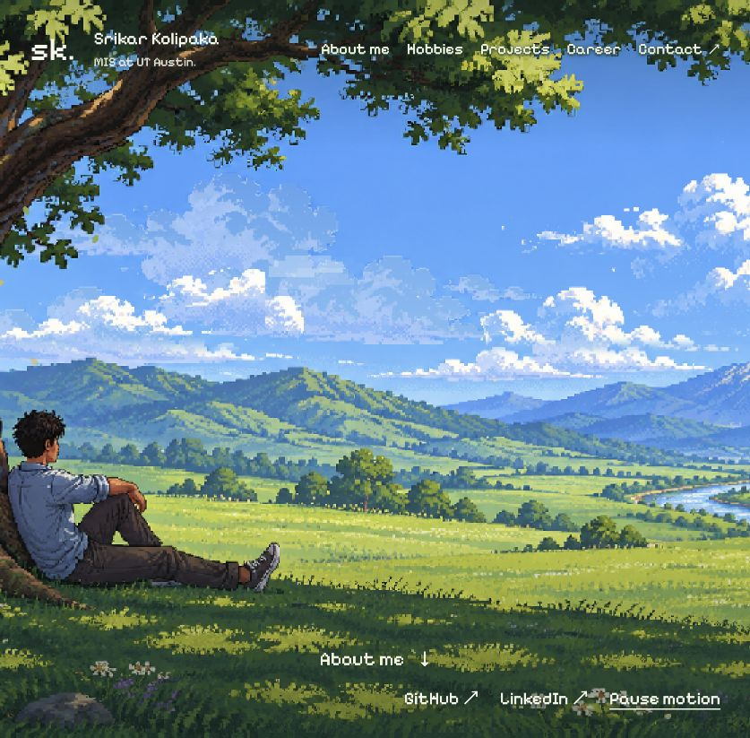

# Srikar Kolipaka · Personal Portfolio

An interactive pixel-art portfolio with a living landscape and dedicated pages for my background, hobbies, projects, career, and contact details.

**[Visit the live portfolio](https://hello-internet.srikarrkolipaka.workers.dev/)**



## The experience

The landing page shows a pixel-art meadow, river, mountains, and a character resting against a tree. Clouds drift, grass moves, leaves fall, and birds cross the scene. Clicking the trees, clouds, water, mountains, and flowers triggers extra effects. Visitors can pause the animation.

About, Hobbies, Projects, Career, and Contact use full-width layouts with matching pixel typography and landscape framing. Project details have their own pages. Navigation remains available without JavaScript, and motion respects reduced-motion preferences.

## Built with

- Astro 7, React 19, and TypeScript
- Cloudflare Workers and the `cf` CLI
- EmDash CMS with Cloudflare D1
- A canvas/WebGL landscape renderer
- Locally served fonts, with their license files in `public/fonts/`

## Run locally

```sh
npm ci
npm run dev
```

Use the local URL printed by the development server. The development script starts both Workers.

```sh
npm run check  # Astro and Worker TypeScript checks
npm run build  # Production build
```

## Project structure

| Path | Purpose |
| --- | --- |
| `src/landscape/` | Animated landing scene, interactions, and styles |
| `src/pages/` | About, Hobbies, Projects, Career, Contact, and project details |
| `src/layouts/PortfolioPage.astro` | Shared full-page layout |
| `src/data/` | Authored biography and project information |
| `public/portfolio/` | Landscape art and page styles |
| `src/app-worker.ts` | Landing scene and app assets |
| `src/fonts.ts` | Embedded fonts served by the app Worker at `/app/*.woff2` |
| `src/worker.ts` | Main site, EmDash, and app service routing |
| `cloudflare.config.ts` | Main and auxiliary Worker configuration |

## Deploy

This project uses **`cf`**, with its configuration in `cloudflare.config.ts`.

```sh
npx cf auth login
npm run deploy
```

The deployment script publishes `hello-app` first, then `hello-internet`, because the main site binds to the auxiliary Worker. Configure your own Cloudflare account and D1 database before deploying a separate copy. Local credentials, databases, build output, and CMS sessions are excluded from this repository.

The production D1 database already has the baseline schema. **Do not replay `migrations/0001_emdash_baseline.sql` against an existing database:** it contains destructive statements. Keep the EmDash scheduled trigger and database binding intact.

Portfolio pages are currently authored in source; the existing CMS/admin remains available separately. Deploying the source does not copy the production CMS database.

## About me

I’m an MIS student at UT Austin. Product management and AI appeal to me because I like figuring out how new technology can solve meaningful problems.

[Portfolio](https://hello-internet.srikarrkolipaka.workers.dev/) · [GitHub](https://github.com/SrikarrKoli) · [LinkedIn](https://linkedin.com/in/srikar-kolipaka)
